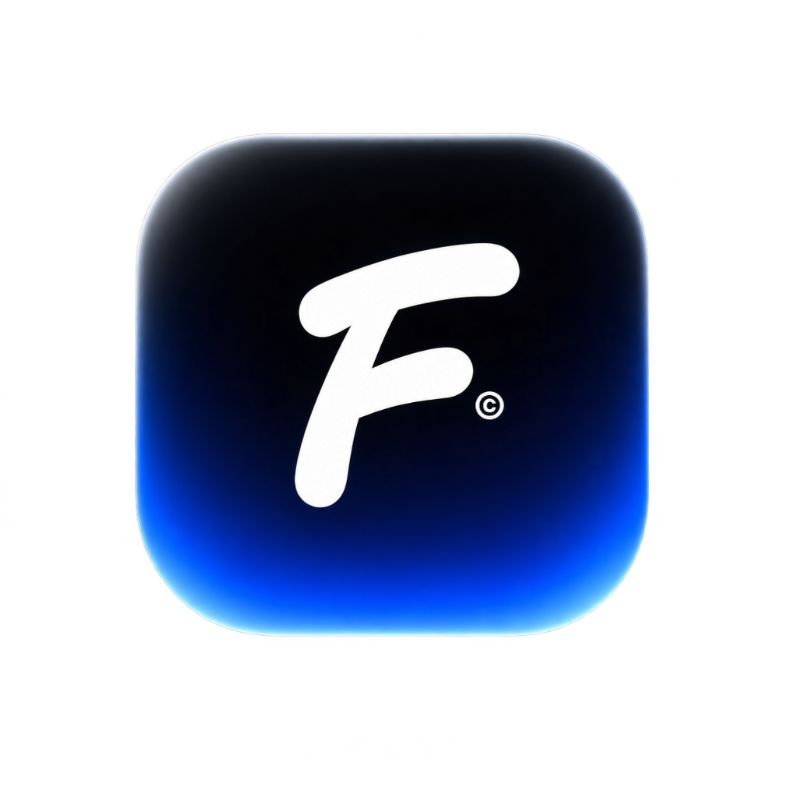

<div align="center">



  **Un dock léger et flottant, inspiré de macOS, pour Windows 10 et 11.**

  Flote remplace la barre des tâches de Windows par un dock personnalisable et
  une barre de menus facultative à la manière de macOS.

  [English](README.md) · [Español](README.es.md) · **Français**
</div>


Agrandissement fluide, aperçus des fenêtres en direct et effet génie facultatif à la réduction.

| Mascotte Clawd | Effet génie à la réduction |
| :---: | :---: |
|  |  |
| **Aperçu de l'utilisation** | **Détail de l'utilisation** |
|  |  |

## Fonctionnalités

- Dock effet verre, avec un agrandissement fluide des icônes sous le pointeur.
- Lancer, épingler, réorganiser et gérer les apps, y compris les apps récentes
  et les fenêtres ouvertes.
- Regrouper des apps épinglées dans une seule icône du dock : déposez une app
  sur une autre, cliquez sur le groupe pour déployer ses apps en éventail, et
  sortez-en une de l'éventail pour la retirer du groupe.
- Survolez une app qui a plusieurs fenêtres pour afficher leurs aperçus en
  direct, avec leur titre ; cliquez sur un aperçu pour passer à cette fenêtre.
  Faites défiler les aperçus pour voir plus de fenêtres, ou appuyez sur Échap
  pour les fermer.
- Les fenêtres réduites se rangent dans l'icône de leur app avec l'effet
  génie ; activez Réglages → Fenêtres → *Afficher les fenêtres réduites* pour
  les garder plutôt sous forme de miniatures en direct à droite du dock.
- Cliquer sur l'app déjà au premier plan la réduit, comme dans la barre des
  tâches de Windows.
- Glisser-déposer des fichiers sur les apps, les Téléchargements ou la
  Corbeille.
- Un dossier de raccourcis à droite du dock : son contenu s'ouvre en menu, avec
  un sous-menu pour chaque dossier qu'il contient, comme une barre d'outils de
  la barre des tâches de Windows 10.
- Masquage automatique facultatif.
- Une barre de menus en haut de l'écran avec l'app au premier plan, l'heure, le
  réseau, le volume et la batterie, la langue de saisie, le micro et la caméra
  en cours d'utilisation, les icônes masquées de la zone de notification, ainsi
  que les boutons Rechercher, Affichage des tâches et Widgets s'ils figurent
  dans votre barre des tâches Windows.
- Un îlot arrondi dans la barre de menus pour les limites d'utilisation de
  Claude Code, Codex, OpenCode Go, Gemini CLI et Antigravity. Les quotas Gemini
  Pro et Flash s'affichent séparément quand ils sont disponibles.
- Une app Réglages séparée, aux changements appliqués en direct, en espagnol,
  anglais et français, avec une animation de réduction façon génie
  configurable.
- Un processus de surveillance rétablit la barre des tâches de Windows si le
  dock se ferme de façon inattendue.

L'effet génie est **activé par défaut** et se désactive dans Réglages →
Fenêtres. Tant qu'il est activé, Flote désactive temporairement les
transitions de Windows pour les fenêtres qu'il suit, afin de pouvoir jouer son
animation de réduction ; ces transitions sont rétablies à la fermeture de
Flote.

## Installer

**[Télécharger Flote-Setup.exe](https://github.com/david-8837/Flote/releases/latest/download/Flote-Setup.exe)**
(Windows 10 version 1903 ou ultérieure, ou Windows 11 ; 64 bits) ou choisissez
une version dans les [Releases](https://github.com/david-8837/Flote/releases).

1. Lancez `Flote-Setup.exe`. Il s'installe pour votre seul compte : sans
   droits d'administrateur, sans assistant, en deux secondes environ.
2. Flote est récent : SmartScreen peut ne pas encore le reconnaître et
   indiquer qu'il a protégé votre ordinateur. Choisissez **Informations
   complémentaires → Exécuter quand même**.
3. Ouvrez **Flote** depuis le menu Démarrer, puis choisissez **Dock** pour
   personnaliser le dock et la barre de menus.

## Essayer sous Windows

### Prérequis

- Windows 10 (version 1903 ou ultérieure) ou Windows 11. Sous Windows 10, le
  dock et la barre de menus sont opaques plutôt qu'en verre : Windows 10 n'offre
  pas de flou d'arrière-plan aux applications de bureau.
- Rust avec la chaîne d'outils MSVC et les Visual Studio C++ Build Tools
- Node.js et pnpm

### Lancer le dock

Depuis la racine du dépôt :

```powershell
cargo run -p muelle
```

Le dock masque la barre des tâches tant qu'il tourne. Appuyez sur **Ctrl+C**
dans le terminal pour le quitter ; Flote devrait rétablir la barre des tâches
automatiquement. S'il faut la rétablir à la main :

```powershell
cargo run -p muelle -- --restore
```

### Lancer Réglages

Laissez le dock tourner, ouvrez un second terminal et lancez :

```powershell
cd apps\settings
pnpm install
pnpm tauri dev
```

La fenêtre native de Réglages s'ouvre. Les changements de l'interface se
rechargent à chaud ; après une modification du backend Rust, relancez
`tauri dev`. Les changements de réglages s'appliquent au dock en cours
d'exécution.

## Compiler et tester

Depuis la racine du dépôt :

```powershell
cargo fmt --all -- --check
cargo test --workspace --locked
```

Pour compiler l'interface de Réglages :

```powershell
cd apps\settings
pnpm build
```

## Organisation du projet

| Chemin | Rôle |
|---|---|
| `apps/dock` | Dock Windows natif |
| `apps/settings` | App de bureau Tauri pour les réglages |
| `crates/muelle-core` | Logique de disposition et d'animation, indépendante de la plateforme |
| `crates/muelle-shell` | Intégration au shell Windows |
| `crates/muelle-config` | Réglages partagés et persistance |
| `muelle` | Site web Astro |

## Confidentialité

Flote ne collecte aucune donnée, n'a pas de télémétrie et n'envoie jamais rien
au projet. Il fait deux sortes de requêtes réseau, toutes deux facultatives :

- **Mises à jour :** Réglages demande à GitHub Releases s'il existe une
  nouvelle version à son ouverture, et une fois par jour, quelques minutes
  après l'allumage de l'ordinateur, Flote fait de même en arrière-plan et
  installe ce qu'il trouve (le dock lui-même n'utilise jamais le réseau).
  Désactivez l'installation dans Réglages → Système → *Installer
  automatiquement les mises à jour*, ou le tout avec *Rechercher
  automatiquement les mises à jour*.
- **Utilisation des fournisseurs d'IA :** tant qu'un client pris en charge
  tourne, Flote lit sa connexion locale existante et demande à ce fournisseur
  les limites disponibles de l'abonnement toutes les cinq minutes tant que
  l'îlot est visible, ou quand vous appuyez sur Actualiser. Pour Gemini CLI et
  Antigravity, les quotas Gemini Pro et Flash s'affichent séparément quand ils
  sont disponibles ; Antigravity est interrogé via son service local. Les
  identifiants restent en mémoire et ne sont jamais enregistrés par Flote.
  Désactivez-la dans Réglages → Barre de menus → *Afficher l'utilisation des
  fournisseurs d'IA*.

Détails : [muelle.crafter.run/privacy](https://muelle.crafter.run/privacy).
